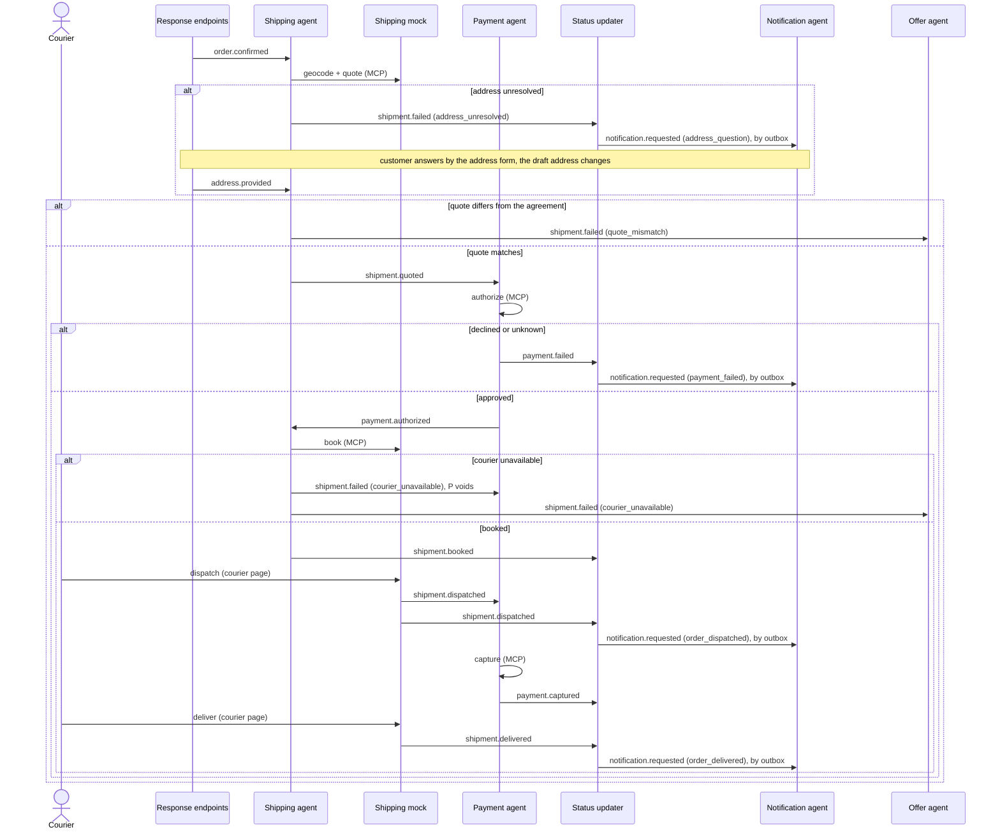
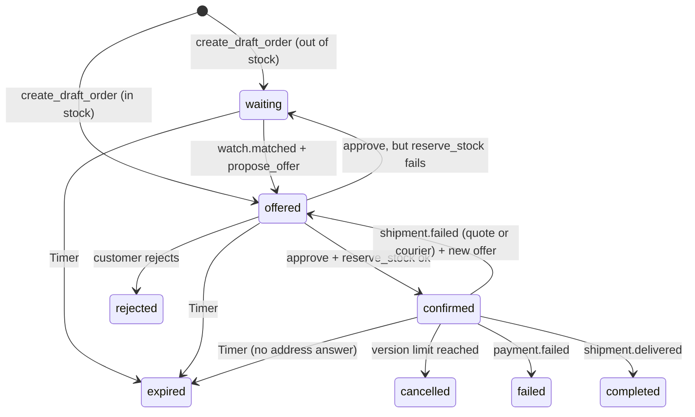

# agent-commerce — v7 design

Status: proof-of-concept blueprint for agent orchestration. The e-commerce shop is the example use case. No code exists.

Diagrams:
- `multi-agent-layers-v7.svg` — **layer view**: what the system is made of.
- `multi-agent-flow-v7.svg` — **flow view**: what happens to an order. Edges e1–e36: the v6 edges plus e35 and e36 (`search_products`, added in the build). The edge list is in the SVG comment. Green numbers 1–9 are the success steps in §4.

Use of this design: show and tell. Then each participant adds one or two new services.
So the main quality goal is: **adding a service changes as few existing boxes as possible.**

Scope: the full order flow, from the first question to the delivery.

---

## 1. Core rules

1. The agent decides what to do. Code checks if it is allowed, and code does it.
2. An agent never charges, changes a price or changes the agreement directly.
3. Agents communicate only by typed events. Each agent runs one bounded turn per event, then stops.
4. A purchase waits durably. No agent runs while a purchase waits.
5. Any change to the agreement (item, quantity, total, delivery) becomes a new offer. The customer approves it.
6. Each agent decision writes a decision record. Emails explain decisions only from these records.
7. **Choreography:** each service reacts to events. No central orchestrator. One event can have many consumers.
8. **One MCP server per domain** holds the guarded tools. The guard runs in the server, not in the agent.
9. **No real email.** The email service prints each email to the console and saves it in its database. The customer reads it on an inbox page.
10. **Customers service** owns customer identity, email address and default delivery address. Each draft stores a `customer_id`.
11. **One path to the customer.** Only the draft outbox emits `notification.requested`. No other event goes to the Notification agent.
12. **Demo login.** The chat page lets the presenter select one customer from seed data.
13. **Every chain of events starts with an actor.** Nothing starts by itself. An actor uses a web page or curl, or it is the clock. Everything else is a reaction.

## 2. Layers

| Band | Contains |
|---|---|
| 1. Actors | Mia (customer), Shop manager, Courier, Clock |
| 2. Entry points | Chat page, Response endpoints (inbox links), Manager page, Courier page, Timer |
| 3. Event bus | RabbitMQ topic exchange `events` |
| 4. Reactors | 6 agents: Shopping, Offer, Inventory, Notification, Shipping, Payment. 3 plain-code reactors: Gate, Status updater, Outbox relay |
| 5. MCP servers | orders, customers, catalogue, email, shipping, payment |
| 6. Services and data | orders DB, customers DB, catalogue mock, email store, shipping mock, payment mock, decisions DB |

Arrows in the layer view connect only neighbour bands. Two notes:
- The Timer does not publish. It changes drafts, and the outbox relay publishes.
- The Gate and the Status updater are in the orders container. They write the orders DB directly, not through MCP.

## 3. Actors and entry points

The endpoint paths are my proposal. Each endpoint is plain HTTP, so a web page and curl use the same call.

| Actor | Entry point | Endpoint (proposal) | What it does |
|---|---|---|---|
| Mia | Chat page | `POST /chat/messages` | Publishes `chat.message` |
| Mia | Inbox links → Response endpoints | `POST /offers/{id}/approve`, `/reject`, `POST /drafts/{id}/address` | Reserves stock and publishes `order.confirmed`; or rejects; or changes the draft address and publishes `address.provided` |
| Shop manager | Manager page (in catalogue-mock) | `POST /manager/restock`, `POST /manager/price` | Changes the stock or the price, then publishes `stock.restocked` or `price.changed` |
| Courier | Courier page (in shipping-mock) | `POST /courier/{tracking_id}/dispatch`, `/deliver` | Publishes `shipment.dispatched` or `shipment.delivered` |
| Clock | Timer (in orders) | Schedule, or `POST /timer/tick` | Expires overdue offers, watches and address waits. Writes the draft and the outbox |

## 4. Success path (green numbers in the flow view)

| Step | Trigger | What happens |
|---|---|---|
| 1 | Mia | Chat message. The Shopping agent creates a waiting draft and a stock watch |
| 2 | Shop manager | Restock. The Gate matches the watch. The Offer agent proposes offer version 1 |
| 3 | Reaction | The Notification agent writes the offer email. Mia sees it on the inbox page |
| 4 | Mia | Approve. The Response endpoint reserves the stock |
| 5 | Reaction | `order.confirmed`. Shipping quotes, Payment authorizes, Shipping books the courier |
| 6 | Courier | Dispatch. The shipping mock publishes `shipment.dispatched` |
| 7 | Reaction | Payment captures. The Status updater sends a "dispatched" email |
| 8 | Courier | Deliver. The shipping mock publishes `shipment.delivered` |
| 9 | Reaction | The Status updater sets the draft to completed and sends a "delivered" email |

Agent turns in the success path: Shopping 1, Offer 1, Shipping 2, Payment 2, Notification 3. Total 9.

## 5. Event catalogue

Each event is an envelope with seven fields: `event_id`, `type`, `occurred_at`, `draft_id`, `offer_version`, `decision_id`, `payload`. The event `type` is the RabbitMQ routing key. `decision_id` is null when the producer is not an agent. The `payload` holds the fields in the "Main payload" column below.

| Event | Producer | Consumers | Main payload | Edge |
|---|---|---|---|---|
| `chat.message` | Chat page | Shopping agent | text, customer_id | e1 |
| `chat.reply` | Shopping agent | Chat page | text, customer_id | e2 |
| `stock.restocked` | Catalogue mock (manager page) | Gate | sku, quantity, price | e31, e5 |
| `price.changed` | Catalogue mock (manager page) | Gate | sku, new_price | e31, e5 |
| `watch.matched` | Gate | Offer agent | watch_id, sku, available_qty, price | e7 |
| `composition.requested` | Offer agent | Inventory agent | sku, quantity | e8 |
| `composition.proposed` | Inventory agent | Offer agent | list of (sku, quantity) | e9 |
| `notification.requested` | Draft outbox | Notification agent | reason, decision_ids | e13 |
| `order.confirmed` | Response endpoints | Shipping agent | offer_version | e20 |
| `address.provided` | Response endpoints | Shipping agent | — (the address is in the draft) | e20 |
| `shipment.quoted` | Shipping agent | Payment agent | quote_id, fee | e23 |
| `shipment.booked` | Shipping agent | Status updater | tracking_id | e21 |
| `shipment.failed` | Shipping agent | Payment agent (void), Offer agent (courier or quote), Status updater | reason: `address_unresolved`, `quote_mismatch`, `courier_unavailable` | e23, e22, e21 |
| `shipment.dispatched` | Shipping mock (courier page) | Payment agent, Status updater | tracking_id | e32, e33, e34 |
| `shipment.delivered` | Shipping mock (courier page) | Status updater | tracking_id | e32, e34 |
| `payment.authorized` | Payment agent | Shipping agent | authorization_id | e24 |
| `payment.captured` | Payment agent | Status updater | capture_id | e25 |
| `payment.failed` | Payment agent | Status updater | reason: `declined`, `unknown` | e25 |

Each consumer reads only the reasons it cares about. For example, the Offer agent ignores `shipment.failed` with reason `address_unresolved`.

### Status updater

Plain code in the orders container. It listens to events and changes the draft. When the customer must know, it writes `notification.requested` to the outbox in the same transaction (e30).

| Event received | Draft change | `notification.requested` reason |
|---|---|---|
| `shipment.failed` (`address_unresolved`) | delivery_status = `address_pending` | `address_question` |
| `shipment.failed` (`quote_mismatch`, `courier_unavailable`) | no change (the Offer agent makes a new offer) | — |
| `shipment.booked` | delivery_status = `booked` | — |
| `shipment.dispatched` | delivery_status = `dispatched` | `order_dispatched` |
| `payment.captured` | payment_status = `captured` | — |
| `shipment.delivered` | delivery_status = `delivered`, state = `completed` | `order_delivered` |
| `payment.failed` | state = `failed` | `payment_failed` |

Other notification reasons come from the orders server and the Timer: `offer_ready` (new offer), `offer_expired`, `watch_expired`, `order_cancelled` (version limit).

## 6. MCP servers and tools

Transport: Streamable HTTP, stateless, path `/mcp`. The MCP ports stay inside the compose network.

| MCP server | Tools | Called by | Guard checks | Edge |
|---|---|---|---|---|
| orders | `create_draft_order`, `register_watch`, `propose_offer`, `get_draft` | Shopping agent, Offer agent; `get_draft` also by the shipping server, the payment server (code) and the Notification agent | Prices come from the catalogue, not the agent. `register_watch` takes `sku`, `quantity`, `max_price`. Max 3 offer versions. The customer exists (`get_customer`). The default address is copied into the draft. `get_draft` is read only: it returns the draft, its current offer, the agreed address and the total | e3, e10, e11, e28 (`get_draft` not drawn) |
| customers | `get_customer`, `get_customer_email` | orders server, email server (code) | Read only | e28, e29 |
| catalogue | `search_products`, `reserve_stock` | `search_products`: Shopping agent, Inventory agent. `reserve_stock`: Response endpoints (code) | `search_products` is read only. `reserve_stock`: offer not expired, version current, stock available | e18 (`search_products` not drawn) |
| email | `send_email` | Notification agent | The agent never passes an address: the server reads it from Customers. Each claim cites a decision_id. Output: console log + `emails` table | e15, e29 |
| shipping | `geocode`, `quote`, `book` | Shipping agent | Uses the draft address. `book` only if the quote matches the agreed fee and the payment is authorized | e26 |
| payment | `authorize`, `capture`, `void` | Payment agent | Amount = approved offer total. The agent never passes an amount. `capture` only after `shipment.dispatched` | e27 |

Address ownership:
- Customers keeps the **default** address. Nothing in this flow changes it.
- The draft keeps the **agreed delivery** address. `create_draft_order` copies it. The address form changes it (e19).

Payment results: `approved` → success event. `declined` → `payment.failed`. `unknown` → the tool queries again (max 3), then `payment.failed`.

## 7. Flow after the customer approves

Why authorize first and capture at dispatch: no money moves before the parcel leaves. So no refund path exists in the success path.

## 8. Draft states

While the state is `confirmed`, the draft also tracks `delivery_status` (address_pending, booked, dispatched, delivered) and `payment_status` (authorized, captured).

## 9. Loops and limits

| Loop | Limit |
|---|---|
| Revision: Shipping → Offer → customer → Response → Shipping | Max 3 offer versions (`propose_offer` guard) |
| Sold out at approve → waiting → new offer | Same counter |
| Offer ↔ Inventory | Max 1 composition request per offer version |
| Waits (offer, watch, address answer) | Timer closes them |

## 10. Status of the 17 gaps from v1

| # | Gap | Fix |
|---|---|---|
| 1 | No shipping result | `shipment.quoted`, `shipment.booked`, `shipment.failed`, plus dispatch and delivery |
| 2 | No payment success | `payment.authorized`, `payment.captured` |
| 3 | No address reply | Address form → draft address → `address.provided` → Shipping |
| 4 | No reject or expiry | Reject link; Timer |
| 5 | Watch not closed | Gate closes it on match |
| 6 | No stock reservation | `reserve_stock` on approve |
| 7 | No refund | Authorize first, capture at dispatch, void on failure |
| 8 | No chat reply | `chat.reply` |
| 9, 10 | Agent charges or books | Guards in the payment and shipping MCP servers |
| 11 | Bus not shown | RabbitMQ band in the layer view |
| 12 | Labels not events | All labels are event, tool or HTTP names |
| 13 | `price.changed` unclear | Matches a watch when new price ≤ the watch `max_price`. An offer keeps its price until it expires |
| 14 | "Composition" undefined | **Assumption:** other SKUs that meet the same need (2 × 500 g in place of 1 × 1 kg). Please confirm |
| 15 | Fulfilment order unclear | Quote → authorize → book → dispatch → capture → deliver (§7) |
| 16 | Payment outcomes unclear | §6 |
| 17 | Revision loop | Max 3 offer versions |

## 11. Agent or plain code (open for discussion)

| Box | Needs an LLM? | Reason |
|---|---|---|
| Shopping, Offer, Inventory, Notification | Yes | Free text, substitutes, explanations |
| Shipping agent | Partly | Only "is this the same address?" needs judgment. The rest are rules |
| Payment agent | No | Every reaction in §7 is a fixed rule |

The diagrams keep Shipping and Payment as agents, as in the original concept.

## 12. How to add a new service

A new service is complete when it has these parts:

1. **Trigger**: an actor and an entry point, if the service starts a new chain. Most services do not: they only react.
2. **Events it consumes**: the names and the reasons it reacts to. Each name becomes a RabbitMQ binding.
3. **Events it emits**: new names. Add them to §5.
4. **MCP server**: its guarded tools. The guard checks every input that changes money, price or the agreement. It owns one Postgres database.
5. **Agent or code**: an LLM only if a step needs judgment. Each agent turn writes a decision record. An agent publishes only through the local tool `emit_event`. The tool accepts an event only if its `type` is in the agent's `emits` list in `agent.json` and its payload passes the schema.

If the customer must know about the new service's result, the Status updater writes `notification.requested`. The Notification agent does not change.

Extension cost, two examples:

| New service | Consumes | Emits | Existing boxes that change |
|---|---|---|---|
| Loyalty points | `shipment.delivered` | `points.awarded` | 1: the Status updater maps `points.awarded` to a `points_awarded` notification |
| Fraud check between authorize and book | `payment.authorized` | `fraud.cleared`, `fraud.flagged` | 3: Shipping waits for `fraud.cleared` in place of `payment.authorized`. Payment voids on `fraud.flagged`. The Status updater maps `fraud.flagged` to a notification |

A service at the end of a chain is cheap to add. A service in the middle of a chain changes the consumers on both sides. This is the main limit of choreography.

## 13. Removed (production detail)

Each item below is valid for production. None is necessary for this blueprint.

- Idempotency keys, duplicate `event_id` drop, `causation_id`, `correlation_id`.
- `hop_count` limit on the bus.
- Restock storm rule (oldest watches first).
- `manual_review` state, for example when capture fails after dispatch.
- Address question limit (max 2).
- `payment.voided` event.
- Explicit `release_stock` and `void` on every failure exit.
- Real login, customer management, and authentication on the manager and courier pages.

## 14. Stack and deployment

Stack: TypeScript, Postgres, RabbitMQ, Docker Compose (`docker compose up`).

### Shared packages

| Package | Holds |
|---|---|
| `events` | event names, envelope schema |
| `bus` | `connect`, `consume`, `publish`, dead-letter setup |
| `db` | pool, `query`, `withTransaction`, migrate, seed |
| `decisions` | decision record writer and its migration |
| `mcp-kit` | `defineTool`, MCP server bootstrap |
| `log` | `log()` |
| `agent-runtime` | the agent loop, MCP client, `emit_event`, `done`, limits |

### Containers

| # | Container | Contains | Database |
|---|---|---|---|
| 1 | chat-ui | Chat page with demo login | — |
| 2 | orders | orders MCP server, Gate, Timer, Response endpoints, Status updater, outbox relay | `orders` |
| 3 | customers | customers MCP server, seed customers | `customers` |
| 4 | email | email MCP server, inbox page | `email` |
| 5 | catalogue-mock | catalogue MCP server, mock, **manager page** | `catalogue` |
| 6 | shipping-mock | shipping MCP server, mock, **courier page** | `shipping` |
| 7 | payment-mock | payment MCP server, mock | `payment` |
| 8–13 | agent-shopping, agent-offer, agent-inventory, agent-notification, agent-shipping, agent-payment | One agent each. All write to the decision log | `decisions` |
| 14 | postgres | One server, 7 databases | — |
| 15 | rabbitmq | Broker with the management UI | — |

Host ports: chat-ui 3000, orders 3001, email 3002, catalogue-mock 3003, shipping-mock 3004, RabbitMQ UI 15672. All MCP ports stay inside the compose network.

The **outbox relay** reads new rows from the `outbox` table and publishes them to RabbitMQ. All `notification.requested` events go out this way.

### Databases (7, one Postgres server)

| Database | Main tables | Owner |
|---|---|---|
| `orders` | drafts, offers, stock_watches, outbox, dropped_events | orders |
| `customers` | customers, addresses | customers |
| `email` | emails | email |
| `catalogue` | products, stock, reservations | catalogue-mock |
| `shipping` | quotes, bookings | shipping-mock |
| `payment` | authorizations | payment-mock |
| `decisions` | decision_records | `packages/decisions` (writer and migration) |

Columns of `decision_records`: `decision_id, agent, event_id, event_type, draft_id, offer_version, model, started_at, duration_ms, tokens_in, tokens_out, tool_calls, emitted_events, output_text, status`. `status` is `ok`, `limit` or `error`.

### RabbitMQ setup

- One **topic exchange**, `events`. Every producer publishes to it. The routing key is the event `type`.
- One **durable queue per consumer**, named after the consumer. Each consumer declares its own queue and bindings when it starts. No central topology file.
- Each consumer uses **manual ack** and **prefetch 1**. One message = one bounded agent turn. Ack after the turn ends.
- A failed turn rejects the message without requeue. The message goes to one `dead-letters` queue.
- The **management UI** (port 15672) shows the queues and the message rates during the demo.

| Queue | Bindings (routing keys) |
|---|---|
| `shopping-agent` | `chat.message` |
| `chat-ui` | `chat.reply` |
| `gate` | `stock.restocked`, `price.changed` |
| `offer-agent` | `watch.matched`, `composition.proposed`, `shipment.failed` |
| `inventory-agent` | `composition.requested` |
| `notification-agent` | `notification.requested` |
| `shipping-agent` | `order.confirmed`, `address.provided`, `payment.authorized` |
| `payment-agent` | `shipment.quoted`, `shipment.dispatched`, `shipment.failed` |
| `status-updater` | `shipment.booked`, `shipment.failed`, `shipment.dispatched`, `shipment.delivered`, `payment.captured`, `payment.failed` |
| `dead-letters` | none. Receives rejected messages from every consumer queue |

A new service declares one queue and its bindings. No existing queue changes.

### Seed data and fault triggers

The demo makes faults happen with fixed seed rows, not with toggles or random faults. The demo script names the row to use.

| Database | Seed rows | Fault rule |
|---|---|---|
| `customers` | Mia (success). Dan (card `card-decline`). Nora (`1 Nowhere Rd`, postcode 0000). Leo (Alice Springs, postcode 0870). Ivy (card `card-unknown`) | The payment mock declines Dan and answers "unknown" for Ivy. The shipping mock cannot geocode Nora. Postcodes 08xx are remote: fee AUD 25.00, the offer default is AUD 10.00 (Leo) |
| `catalogue` | Coffee beans 1 kg (out of stock at start), coffee beans 500 g, black tea 250 g, stovetop kettle | The shipping mock has no courier for the kettle (`courier_unavailable`) |
| `payment` | No rows | The card reference decides the result; `unknown` is queried 3 times |

### Decided after v7 (10 Nov 2026, Phase 0 of the work plan)

| Item | Decision |
|---|---|
| G1 | `search_products` on the catalogue server, read only |
| G2 | The agent runtime has a local tool `read_decisions(decision_ids)` for the Notification agent |
| G3 | `get_draft` on the orders server, read only. The shipping and payment servers call it as MCP clients |
| G4 | `stock.restocked` carries `price` |
| G5 | `chat.reply` carries `customer_id` |
| G6 | Fault triggers are seed rows (table above) |
| Open items from the handoff | Accepted as written: `x-dead-letter-exchange` on each consumer queue, composition as "other SKUs that meet the same need", Shipping and Payment stay agents, the endpoint paths in §3 |

Diagrams (redrawn 11 Nov 2026): the flow view draws `search_products` from the Shopping agent (e35) and from the Inventory agent (e36); `read_decisions` is edge e14. The layer view lists every tool per MCP server and marks the tools only code calls with "(code)". The `get_draft` calls and the other code-only reads are not drawn as arrows; table B2 lists them.

### Decided during the build (11 Nov 2026, Phases 2–4)

Code needed these answers; the design above did not give them. Review each; change the code if you disagree.

| # | Topic | Decision |
|---|---|---|
| B1 | Shipping fee in an offer | The latest shipping quote for the draft, else a default of AUD 10.00 (`DEFAULT_SHIPPING_FEE`). The orders server reads it with `get_quote` |
| B2 | Read tools for code | Not for agents: catalogue `get_products`, shipping `get_quote` and `get_booking`, payment `get_authorization`. Server-to-server calls: orders → catalogue, customers, shipping; email → orders, customers; shipping → orders, payment; payment → orders, customers, shipping |
| B3 | Tool allow-list | `agent.json` has a `tools` list. An agent sees only those MCP tools, so the Shopping agent cannot call `reserve_stock` |
| B4 | `decision_id` in tools | The runtime sends the turn's `decision_id` as header `x-decision-id`. `offer_ready` cites the decision that made the offer |
| B5 | In stock at the first message | `create_draft_order` makes offer version 1 itself (§8: `[*] → offered`) |
| B6 | `max_price` | Per unit, in cents. The budget of an offer is `max_price × requested quantity`; a composition can use it |
| B7 | Gate with part of the stock | The watch matches; the Offer agent asks for a composition for the missing units. Watches match oldest first; the Gate counts the stock down |
| B8 | Payloads | `stock.restocked` and `price.changed` carry `available_qty`; `composition.proposed` has an optional `note` |
| B9 | Status updater | Also maps `payment.authorized` to `payment_status = authorized`. It acts only on `confirmed` drafts; other events go to `dropped_events` |
| B10 | Timer | An expired address wait sets `expired` and sends reason `address_expired` (new). `POST /timer/tick {"advance_minutes": N}` moves the clock for the demo |
| B11 | Stock | `reserve_stock` replaces the draft's older reservation. Reservations are never released (§13). Sold out at approve: `waiting` and a new watch |
| B12 | Version limit | A 4th `propose_offer` cancels the draft and sends `order_cancelled` |
| B13 | Email links | The email server builds them from `PUBLIC_BASE_URL_ORDERS`. The `send_email` guard refuses links and email addresses in the body |
| B14 | Pages | An orders board on :3001 (drafts, history, decision records, Timer buttons). Orders answers inbox form posts with a small HTML page |
| B15 | Demo fallback | `AGENT_MODE=scripted`: each agent runs `scripted.ts` with the same tools, guards, events and decision records |
| B16 | Ports | customers 3005 and payment-mock 3006, internal. Postgres 55432 and AMQP 55672 on the host for `scripts/dev-host.sh`. `/mcp` shares the page port, so the orders, email, catalogue and shipping MCP servers are reachable from the host (MCP Inspector) |
| B17 | Turn limits | `max_tokens` 4096 (thinking counts toward it on current models), effort `low`, the API's refusal fallback on |
| B18 | History | Table `draft_history` in `orders`, for the board |
